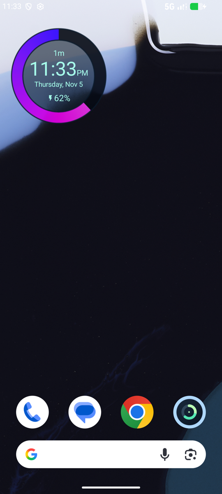
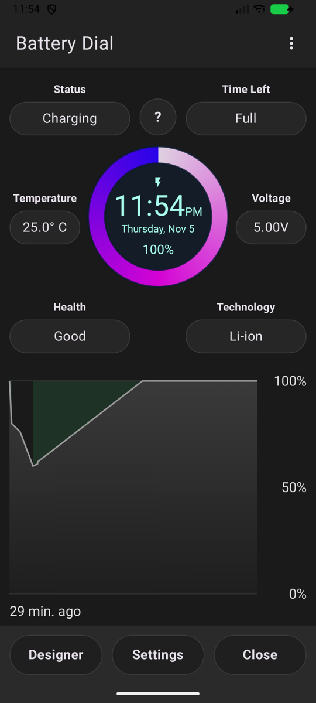
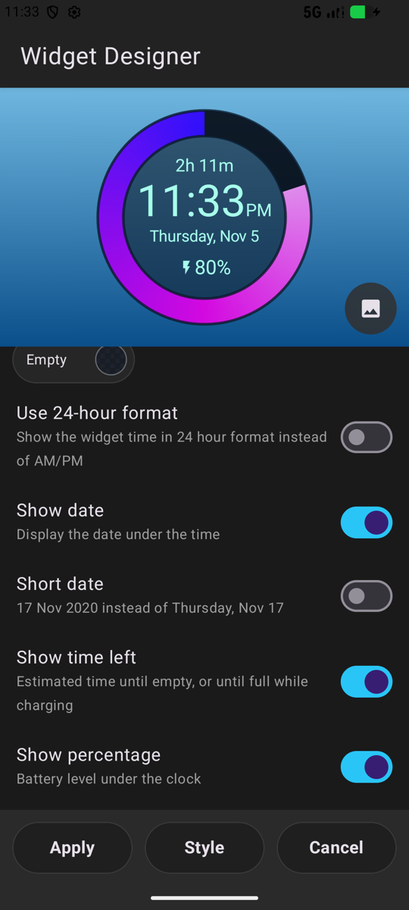
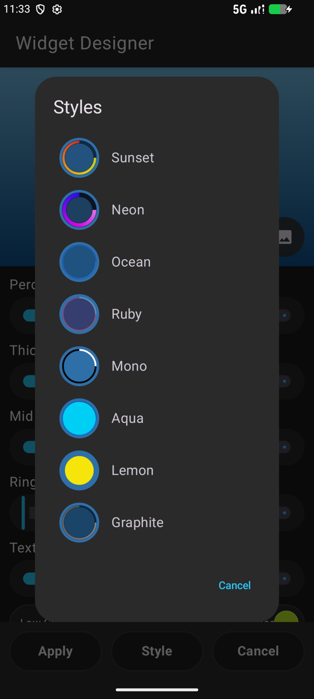

# Battery Dial

A battery widget that is also a clock, for **Android 15 and newer**. A round home screen widget shows the time, date and battery level on a colored ring. The app shows battery details and a charge history graph, and estimates how long until the battery is empty or full.

An independent reimplementation of the features of [Battery Clock](https://play.google.com/store/apps/details?id=it.braincrash.batteryclock.free) by BrainCrash Soft. Not affiliated with it; no code or artwork from it.

<p>




</p>

## Features

**Widget**
- Resizable round dial. The ring fills counter-clockwise from 12 o'clock, colored by a low → mid → high gradient, so its tip's color reads as the level.
- Time (12-hour with small AM/PM, or 24-hour), date (long or short), battery percentage, charging bolt.
- Optional estimated time until empty, or until full while charging.
- Tap anywhere to open your clock app.
- Each widget has its own look: long-press it and pick the customize option, or set the default from the app's Designer.

**App**
- Status, time left, temperature (tap to switch °C / °F), voltage, health and technology.
- Live dial. Tap it for a big percentage instead.
- History graph over 1, 3 or 7 days, with charging periods shaded.
- Widget Designer: ring thickness, gradient midpoint, ring spacing and text size; seven colors with transparency; switches for every element; eight preset styles; preview over one of your own photos.
- Add the widget from the ⋮ menu.

## Privacy and permissions

The app has **no internet permission**, so it cannot send anything anywhere. Battery history and widget styles stay in app-private storage, and backup is off. CI fails the build if the APK's permissions change or network code appears.

| Permission | Why |
|---|---|
| `FOREGROUND_SERVICE`, `FOREGROUND_SERVICE_SPECIAL_USE` | Android only delivers battery changes to a running app. A foreground service with a silent notification keeps the widget and history current. You can hide the notification from Settings. |
| `RECEIVE_BOOT_COMPLETED` | Restarts that service after a reboot. |
| `POST_NOTIFICATIONS` | Declared so the notification can be turned on in system settings. Never requested. |
| `REQUEST_IGNORE_BATTERY_OPTIMIZATIONS` | The "Unrestricted battery use" button in Settings, so battery savers don't pause widget updates. |
| `DYNAMIC_RECEIVER_NOT_EXPORTED_PERMISSION` | Added by AndroidX for app-internal broadcasts. |

## How time left is estimated

The app records a sample each time the level or the power source changes. Once the level has moved twice since you plugged in or unplugged, it uses that session's rate. Before that, it uses the average rate of past sessions of the same kind. While charging, Android's own estimate wins when the phone provides one. The logic is in `timeLeft()` in `Battery.kt`, with tests in `EstimateTest.kt`.

## Build

Needs JDK 17+ and the Android SDK (platform 37).

```sh
./gradlew testDebugUnitTest assembleRelease
adb install -r app/build/outputs/apk/release/app-release.apk
```

Local release builds are signed with your debug key.

## Releases

Every push to `main` builds, tests and publishes a GitHub release with the APK. Without a release key, each CI build is signed with a throwaway key, so a new build only installs after uninstalling the old one. For a stable key, add these repository secrets:

| Secret | Value |
|---|---|
| `BATTERYDIAL_KEYSTORE_B64` | `base64 -i release.jks` |
| `BATTERYDIAL_KEYSTORE_PASSWORD` | Keystore password |
| `BATTERYDIAL_KEY_ALIAS` | Key alias (default `batterydial`) |
| `BATTERYDIAL_KEY_PASSWORD` | Key password (defaults to the keystore password) |

## Code map

| File | What |
|---|---|
| `Battery.kt` | Battery readings, history file, time-left estimator |
| `Dial.kt` | Styles and presets, ring drawing, widget views, widget provider |
| `Monitor.kt` | Foreground service and boot receiver |
| `MainActivity.kt` | Main screen, history graph, settings |
| `DesignerActivity.kt` | Widget Designer, color picker, preset list |
